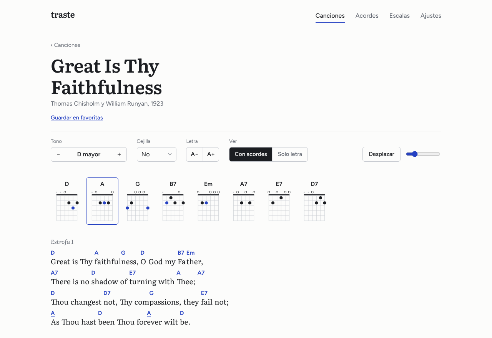
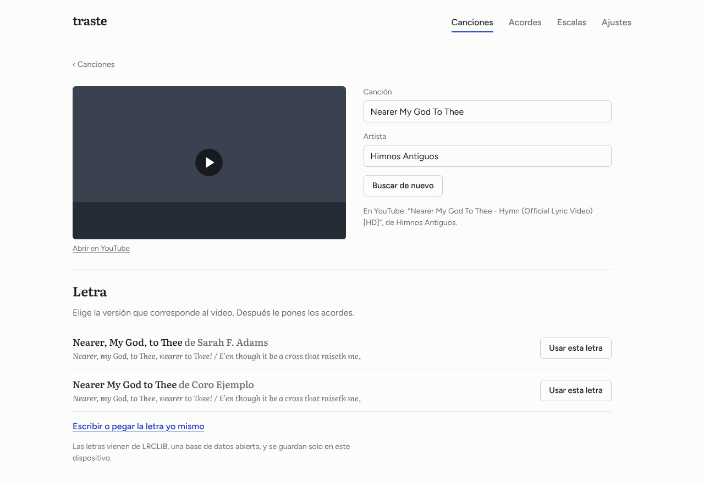
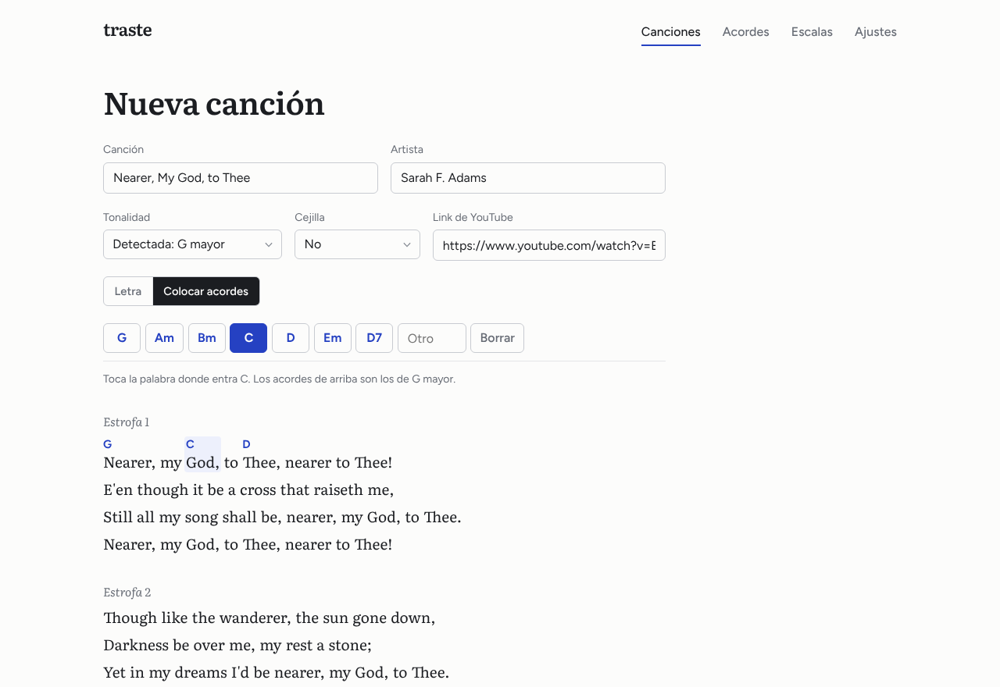
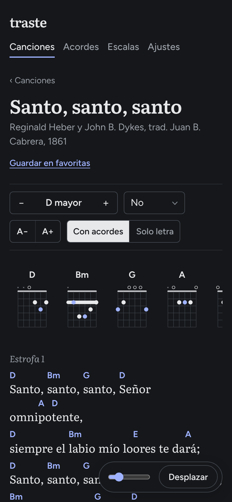

# Traste: letra y acordes para tocar en la iglesia

Una app web para guitarristas de alabanza. Pegas el link de YouTube de la canción, la app reconoce cuál es y trae la letra, le pones los acordes con un toque sobre cada palabra, y queda lista para tocar: con los diagramas arriba, cambio de tono y cejilla, desplazamiento automático y las escalas para improvisar en esa tonalidad.



| Pegar un link | Colocar acordes | En el celular, de noche |
| --- | --- | --- |
|  |  |  |

## Cómo se usa

1. **Pega el link** del video en la pantalla de inicio (sirve `youtube.com/watch`, `youtu.be`, Shorts, YouTube Music o transmisiones en vivo).
2. La app lee el título del video y separa canción y artista: "Elevation Worship - Tu Fidelidad (Video Oficial)" se convierte en *Tu Fidelidad* de *Elevation Worship*.
3. Si la canción ya está en la biblioteca, la abre y deja el video guardado con ella. Si no, **busca la letra** y muestra las versiones encontradas.
4. Eliges la letra y entras a **Colocar acordes**: arriba aparecen los acordes de la tonalidad y basta con tocar la palabra donde entra cada uno. La tonalidad se detecta sola a partir de los acordes que vas poniendo.
5. Si ya tienes la hoja con acordes (de un cancionero o de tu carpeta), la **pegas tal cual**: los acordes de la línea de arriba se acomodan sobre la sílaba que les corresponde. También entiende cifrado latino (Do, Rem, Sol7) y ChordPro.

## En la hoja de la canción

- Letra en tipografía de lectura con el acorde encima de la sílaba exacta donde cambia.
- **Diagramas** de todos los acordes de la canción arriba. Tocar un acorde lo hace sonar.
- **Tono** medio tono arriba o abajo, con sostenidos o bemoles según la tonalidad.
- **Cejilla**: la hoja muestra la forma que se toca. "Be Thou My Vision" en D con cejilla en el 2 se toca con formas de C.
- **Desplazar**: la página baja sola a la velocidad elegida para no soltar la guitarra. En el celular el botón queda abajo, a mano.
- Tamaño de la letra, vista **solo letra** para cantar, modo **oscuro** para la tarima e impresión limpia.
- **Para improvisar**: escalas sugeridas según la tonalidad y los acordes (si la canción en menor tiene el V mayor, aparece la menor armónica), dibujadas en el diapasón por posiciones y con la cejilla marcada.

## ¿En qué tono está?

En **Progresión** escribes los acordes en el orden en que los tocas (`D A/C# Bm G`, o `Do Sol Lam Fa`) y la app te dice:

- La **tonalidad** más probable y la relativa como alternativa (G mayor o E menor), con cuántos acordes encajan.
- El **grado** de cada acorde (I, V, vi, IV), con los prestados marcados.
- Con qué **cejilla** tocarla si la tonalidad es incómoda: Bb con cejilla en el 1 se toca con formas de A.
- Las **escalas para el solo** sobre el diapasón, y un botón para escuchar la progresión.

La progresión queda en la dirección de la página (`#/progresion?acordes=G-D-Em-C`), así que se puede guardar o compartir. Si escribes acordes en el buscador de inicio también te lleva ahí.

Además: diccionario de 16 tipos de acorde, explorador de escalas, favoritas, búsqueda por una frase de la letra o por acorde, notación latina y modo zurdo.

## Tecnologías

| | |
| --- | --- |
| Interfaz | React 19 + TypeScript estricto + Vite |
| Estado | Redux Toolkit: `createSlice`, `createEntityAdapter` para las canciones propias, `createSelector` |
| Datos remotos | **RTK Query**: el catálogo (JSON estático) y dos servicios públicos con `queryFn` propias: oEmbed para el título del video y [LRCLIB](https://lrclib.net) para las letras, con caché y reintento por varias búsquedas |
| Rutas | React Router 7 (`createHashRouter`) |
| Teoría musical | [Tonal](https://github.com/tonaljs/tonal), más detección de tonalidad propia |
| Audio | Web Audio API con síntesis Karplus-Strong |
| Gráficos | Diagramas y diapasón generados en SVG, accesibles con lector de pantalla |
| Calidad | Vitest + Testing Library (94 pruebas, sin salir a internet), oxlint, CI en GitHub Actions |

### Decisiones

- **Formato ChordPro** para guardar las canciones: `A[G]mazing [G7]grace`. Es el estándar de los cancioneros digitales, se transpone con una expresión regular y no depende de espacios ni de fuentes monoespaciadas. `src/lib/chordpro.ts` convierte desde hojas con acordes encima, detecta encabezados (Coro, Puente, `[Intro]`) y nombra solo las partes: un bloque que se repite es el coro.
- **Los acordes no se descargan.** No existe una fuente abierta de acordes, y copiar los de sitios como LaCuerda o Ultimate Guitar va contra sus condiciones de uso. Por eso la app hace rápido lo que sí se puede: traer la letra y poner los acordes con un toque.
- **Letras y derechos de autor.** Los himnos incluidos son de dominio público (publicados antes de 1929). Las letras de canciones actuales vienen de LRCLIB solo cuando el usuario las busca, y se guardan únicamente en su dispositivo.
- **El video se carga al tocarlo**: la miniatura pesa unos KB y el reproductor de YouTube más de 1 MB.

### Estructura

```
src/
  app/            store, hooks tipados, persistencia en localStorage
  features/
    catalog/      RTK Query: himnos incluidos
    web/          RTK Query: datos del video (oEmbed) y letras (LRCLIB)
    library/      canciones propias, favoritas, video, tono y cejilla por canción
    prefs/        notación, tema, tamaño de letra, zurdo
  lib/            chordpro, youtube, teoría musical, posiciones de acordes, audio
  components/     Sheet, ChordDiagram, Fretboard, Improvise, Video, Layout
  pages/          Biblioteca, VideoImport, Canción, Progresión, Editar, Acordes, Escalas, Ajustes
public/data/      canciones.json (himnos de dominio público)
tests/
```

## Correr el proyecto

Requiere Node 20.19 o superior.

```bash
npm install
npm run dev        # http://localhost:5173
npm test
npm run build      # versión para publicar en dist/
```

> En Windows con PowerShell, si aparece "running scripts is disabled", usa `npm.cmd` en lugar de `npm`.

### Sin instalar nada

`portable/index.html` es la app completa en un solo archivo: se abre con doble clic. Para buscar letras necesita internet. Abierto como archivo, YouTube a veces no deja reproducir el video dentro de la página; el enlace "Abrir en YouTube" siempre funciona, y con `npm run dev` o publicada en internet el video se reproduce normal. Se regenera con `npm run build:portable`.

## Himnos incluidos

Santo, santo, santo · Castillo fuerte es nuestro Dios · Oh, qué amigo nos es Cristo · Estad por Cristo firmes · Amazing Grace · Great Is Thy Faithfulness · It Is Well with My Soul · Be Thou My Vision · Blessed Assurance · Come, Thou Fount · What a Friend We Have in Jesus · Holy, Holy, Holy · Doxology. Más tres progresiones para practicar improvisación (adoración en G, ministración en D, intercesión en Em).

Los acordes son de referencia, en tonalidades cómodas para guitarra.

## Licencia

MIT. Orlando Castillo, 2026.
